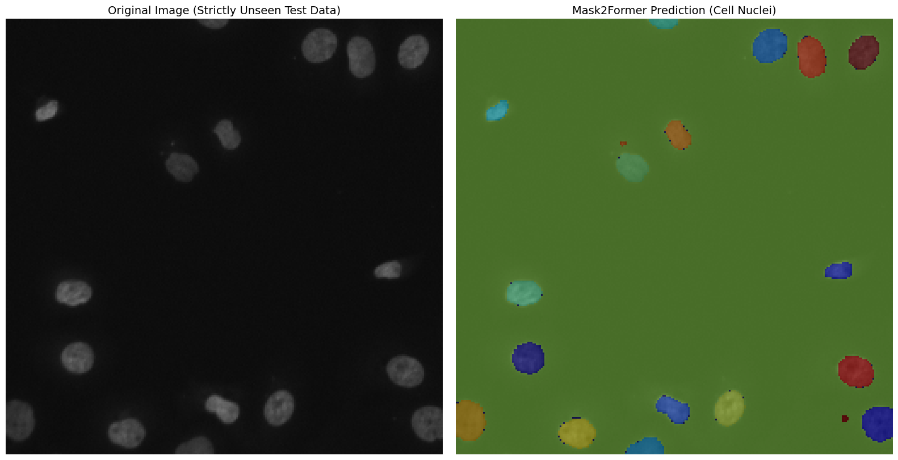

# 🔬 Medical Nuclei Sentinel: Instance Segmentation with Mask2Former

[](https://huggingface.co/)
[](https://pytorch.org/)
[](LICENSE)

**Medical Nuclei Sentinel** is a production-ready, end-to-end Machine Learning pipeline designed for robust **Instance Segmentation** of cell nuclei in histopathology and fluorescent microscopy images. 

Built upon Meta's state-of-the-art **Mask2Former (Swin-Tiny backbone)**, this project overcomes severe medical data scarcity by utilizing dynamic biologically-aware augmentations and strict MLOps principles.

---

## 📌 Segmentation Results
*Predictions captured on strictly unseen biological tissues:*

<div align="center">
  
</div>

> The model successfully delineates tightly clustered, overlapping cell nuclei with high pixel-level accuracy across distinct imaging modalities (e.g., H&E vs. Fluorescent).

---

## 📊 Scientific Evaluation & Metrics
Unlike standard loss monitoring, the model was evaluated on a **strictly isolated 10% Test Set** that was entirely unseen during both training and validation phases. 

The model achieved near-human pixel accuracy:

| Metric | Score | Clinical Standard |
| :--- | :---: | :---: |
| **Mean DICE Score (F1)** | **`0.9763`** | `> 0.80` |
| **Mean IoU (Jaccard)** | **`0.9680`** | `> 0.70` |

---

## ⚙️ Medical-Aware Training Strategies & MLOps
Standard augmentation and validation loops often fail or leak in medical imaging. This pipeline employs clinical-grade strategies:

*   **Strict Zero Data Leakage:** Implemented a seeded `80/10/10` (Train/Validation/Test) split ensuring the model is evaluated exclusively on clinically unseen data.
*   **Biological Deformity Simulation:** Utilized `Albumentations` to apply **Elastic Transformations** (`sigma=50`), accurately simulating the natural, non-rigid deformation of biological cells to prevent overfitting.
*   **Hardware-Agnostic Auto-Tuning:** Dynamic allocation of DataLoader CPU workers (`os.cpu_count()`) to prevent GPU starvation and RAM crashes across diverse hardware environments.
*   **Automated Optimal Checkpointing:** Continuous tracking of `eval_loss` with `load_best_model_at_end=True` to automatically discard overfitted epochs and retain the mathematically optimal model.

---

## 🧠 Technical Challenges & Solutions
<details>
<summary><b>Click to expand the MLOps & Debugging log</b></summary>

Throughout the development of this pipeline, several architectural and infrastructural challenges were addressed:

1. **Hugging Face `accelerate` Cache Bug (Interactive Environments):**
   * *Issue:* Running the `Trainer` sequentially in Jupyter/Kaggle caused state conflicts due to `accelerate` aggressively caching hardware states.
   * *Solution:* Implemented `AcceleratorState._reset_state()` to forcefully flush the hardware cache prior to model initialization, ensuring stable consecutive runs.

2. **Multi-GPU `DataParallel` Limitations with Complex Architectures:**
   * *Issue:* Default PyTorch `DataParallel` struggles with the complex nested structure of `Mask2Former` (e.g., Pixel Decoder & Swin backbone), causing device mismatch errors.
   * *Solution:* Enforced single-GPU training using `os.environ["CUDA_VISIBLE_DEVICES"] = "0"` and compensated for speed by optimizing DataLoader CPU workers dynamically.

3. **Data Leakage in Validation Loops:**
   * *Issue:* Evaluating the final model on the validation dataset causes "Selection Bias" since the model was implicitly tuned on it via `load_best_model_at_end=True`.
   * *Solution:* Implemented a strict three-way split using a seeded generator. The final Inference and Metric calculations (DICE/IoU) are strictly executed on the untouched 10% Test Set.

4. **Rigid Transformations vs. Biological Tissues:**
   * *Issue:* Standard augmentations (like 90-degree rotations) are insufficient for histopathology, as biological cells deform non-rigidly.
   * *Solution:* Integrated `Albumentations` with `A.ElasticTransform` to dynamically simulate natural cellular elasticity on-the-fly, dramatically boosting the DICE score to ~97.6%.

</details>

---

## 🚀 Quick Setup

### 1. Clone & Install Dependencies
```bash
git clone https://github.com/AmirhosseinBagherinia-dl/medical-nuclei-mask2former.git
cd medical-nuclei-mask2former
pip install -r requirements.txt
```

### 2. Download Pretrained Weights
1. Download the highly-optimized model weights from **[Google Drive](https://drive.google.com/file/d/1Rs7WQYxgrgk4Ze7VI_UdglQ2agEBQXTV/view?usp=sharing)**.
2. Extract the `.zip` file and place its contents into a folder named `best_model/` inside the root directory.

### 3. Run Inference via Command Line
You can test the model on any unseen biological image using the standalone CLI script:
```bash
python inference.py --model_dir ./best_model --source data/sample_cell.png --conf 0.5
```
*The script will output the cell count and save the visualized masks as `inference_output.png`.*

### 4. Interactive Notebook
To view the complete training process, logs, and evaluation metrics without running the code, simply open the `dsb2018.ipynb` file directly in GitHub. This file contains the entire end-to-end pipeline, from data extraction to model evaluation.

---

## 📁 Dataset
This project uses the official **2018 Data Science Bowl** dataset hosted on [Kaggle](https://www.kaggle.com/c/data-science-bowl-2018), featuring a diverse set of nuclei images acquired under various conditions and magnifications.

---

## 📬 Contact
Created by [Amirhossein Bagherinia](https://github.com/AmirhosseinBagherinia-dl) - feel free to contact me for collaborations!